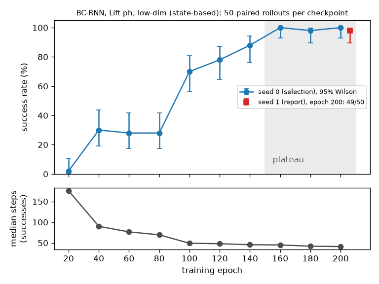
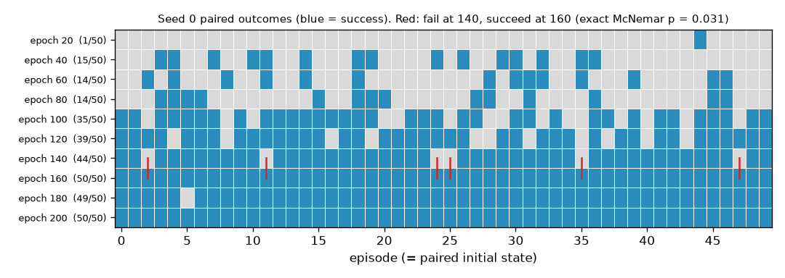

# Baseline: pins, entry points and handoffs

## Stack (route B, D1)

Simulator pins are chosen per dataset by action replay (D6, evidence below). Two sim envs:
`sim` (`requirements/sim.txt`) for Lift and Can, `sim-square` (`requirements/sim-square.txt`)
for Square. They differ only in robosuite and MuJoCo.

| Component | Pin | Why |
|---|---|---|
| Python | CLAIX `Python/3.11.5` (with `GCCcore/13.3.0`) | Wheels exist for all packages below |
| robosuite | `sim`: v1.5.2 tag, `824ac14cefcfb7ec125fe5eb2e0bad7364466154`; `sim-square`: v1.5.1 tag, `51cc01785bab80ffeed20da15e67d7dd4140e76a` | The datasets record v1.5.1; 1.5.1 vs 1.5.2 gave identical replay outcomes. v1.5.2 requires `mujoco>=3.3.0`, so Square needs v1.5.1 |
| MuJoCo | `sim`: `mujoco==3.9.0`; `sim-square`: `mujoco==3.2.7` | Highest replay success per dataset (table below). robosuite master caps `<3.10`: 3.10 changed `mj_fullM` and breaks its controllers; the v1.5.x releases lack the cap |
| robomimic | master `d309eaecc18acf4152a830a895a6984b8ac71b05` (2026-08-09) | v0.5.0 + 15 fixes, incl. the current dataset HF repo; has `DiffusionPolicyUNet` |
| PyTorch | sim env `torch==2.15.0+cpu`; trainer env `torch==2.15.0` (PyPI CUDA 13.2 build, H100 driver unverified) | Checkpoints must load across envs |
| Data | HF `robomimic/robomimic_datasets` `v1.5/{task}/ph/`, revision `74fa018461f479cd9fd15b924a16103012096203`. sha256 `demo_v15.hdf5` / `low_dim_v15.hdf5`: Lift `68f2a8cf…f37` / `2067777c…aeb540`; Can `86961df8…6d73d` / `3f2eb92e…282962`; Square `3d9d6cad…e61e596` / `45d8cabb…14951` | Local files match the Hugging Face LFS hashes (verified 2026-11-21) |
| Rendering | `Mesa/24.1.3` module, `MUJOCO_GL=osmesa` (verified in a CPU job) | No system libOSMesa on CLAIX |

### Replay success per MuJoCo version (ph `low_dim_v15.hdf5`, 200 demos each)

`jobs/replay_check.py` replays each demo's recorded actions open-loop from its recorded
initial state and checks task success. Every demo is recorded as successful.
`jobs/pin_sweep.sh` layers other robosuite/MuJoCo versions over the `sim` venv.

| Task | 3.2.3–3.2.6 | 3.2.7 | 3.3.0 | 3.9.0 | Pin |
|---|---|---|---|---|---|
| Lift | – | 199 | 200 | **200** | 3.9.0 |
| Can | – | 189 | 191 | **194** | 3.9.0 |
| Square | 181 each | **181** | 176 | 162 | 3.2.7 |

- Jobs (robosuite 1.5.1 unless noted). Lift: 5928735, 5928932, 5813465 (1.5.2). Can:
  5928736, 5928933, 5896700 (1.5.2). Square: 5927735, 5927736, 5928123, 5928124, 5920277,
  5920278, 5920414; robosuite 1.5.2 on 3.3.0 and 3.9.0: 5920415, 5897045.
- robosuite 1.5.1 and 1.5.2 give the same outcome on every Square demo. The dataset stores
  the scene MJCF, so robosuite contributes only the controller and the success check.
- Square on MuJoCo 3.2.3–3.2.7 is bit-identical (same failures, same max state error per
  demo). The first change is at 3.3.0.
- Lift and Can improve with newer MuJoCo while Square degrades. The datasets record only
  robosuite `env_version` 1.5.1, and robosuite 1.5.1 accepts any `mujoco>=3.2.3`, so the
  datasets were probably converted from the 2021 recordings with different MuJoCo versions.
  This is an inference; the MuJoCo version is not stored.
- Square failures are post-contact. On 3.9.0: 20 jam on the peg, 10 succeed only after
  extra hold steps, 8 slip in transport. On 3.2.7: 7, 8 and 4. Twelve demos fail on every
  version (7, 12, 60, 66, 77, 106, 139, 153, 158, 164, 196, 199). Can failures diverge
  only after release (error < 2 mm at release).
- The version effect on Square is not noise: 3.2.7 vs 3.9.0, 25 vs 6 discordant demos
  (exact McNemar p = 0.0009).
- Observation: environment consistency with the data matters more for contact-rich tasks.
  Replay success measures that consistency, not the ceiling of a learned policy.
- Lesson: the pins were first validated on Lift, the least sensitive task. Validate on the
  most contact-sensitive task.

Square on the `sim-square` venv (`jobs/replay.sh square`, job 5929426, 10 min): 181/200,
per-demo outcomes and max state errors identical to the overlay run 5920277. In the MP4
(`20_percent_valid`, 4 demos) demo_32 now succeeds; on 3.9.0 it jammed on the peg.

### Replay validation (Lift ph, `low_dim_v15.hdf5`)

`jobs/replay.sh lift` (CPU `devel`, job 5813465, 3.5 min, MaxRSS 2.4 GB):
- `jobs/replay_check.py`: **200/200** demos reach task success open-loop; first-success
  step matches the recording for 169, differs by ±1 step for 31. The dataset was recorded on
  robosuite 1.5.1; robomimic's version-mismatch warning is therefore harmless here.
- State drift is dominated by qvel spikes at contact (max qpos error ≈ 0.08, max qvel error
  ≈ 13 on the worst demo); judge replay by task success, not exact state equality.
- Upstream `playback_dataset.py` MP4 of the `20_percent_valid` mask (4 demos): all lifts
  visually confirmed. Use `--filter_key`, not `--n` (unseeded shuffle), and `--video_skip 1`.

### Trainer env and CPU training cost (Lift ph, BC-RNN low-dim)

Trainer venv (`requirements/train.txt`): robomimic editable, installed with `sim.txt` as
pip constraints; no robosuite/MuJoCo. robomimic imports `six` without declaring it.

`jobs/lift_bc_rnn_cpu.sh` (CPU `devel`, 200 epochs, in-training rollouts off), config =
`configs/lift/bc_rnn_low_dim.json` + overrides recorded in the job script:

| Job | Cores | Elapsed | Train epoch (median) | Valid epoch | MaxRSS |
|---|---|---|---|---|---|
| 5824723 | 4 | 20:16 | 5.66 s | 0.15 s | 1.0 GB |
| 5824724 | 8 | 19:16 | 5.40 s | 0.14 s | 1.0 GB |

- Both jobs used ≈1.9 cores on average (TotalCPU / elapsed); 8 cores gave no speed-up.
  Use `-c 4`; `-c 2` is untested.
- Full paper run (2000 epochs × 100 steps) ≈ 3.2 h ≈ 13 core-h at 4 cores: fits one
  regular CPU job, or ≈4 `devel` chunks with `--resume` (resume untested).
- Logged losses are identical epoch by epoch in both jobs (training seed 1, CPU).
- Train loss (GMM NLL) 1.35 → −18.9; logged validation loss ≈ 2×10⁶. Cause: robomimic
  computes validation in eval mode, where `low_noise_eval` replaces every GMM std by 1e-4.
  Checked on epoch 200 (one batch of 100 sequences each): in train mode the NLL is −18.5 on train and
  −18.2 on valid (no overfitting); in eval mode it is ≈2×10⁶ on both. The logged validation
  loss is therefore uninformative for this config; select checkpoints by rollouts (0.4).

### Rollout seeding (robosuite 1.5)

`run_trained_agent.py --seed` seeds only `np.random` and `torch` (policy GMM sampling).
robosuite 1.5 draws object placement from the env's own `default_rng(env_kwargs["seed"])`,
which is `None` in the dataset metadata, so initial states are unseeded. Verified
2026-11-17: same `np.random.seed` → different cube positions; `env_kwargs["seed"]=0` →
identical. Paired checkpoint evaluation therefore needs the env seed set (0.4).

### Closed-loop checkpoint evaluation (0.4, state-based)

`jobs/lift_eval_cpu.sh` → `jobs/eval_checkpoints.py` (upstream `rollout()`, env seed set),
checkpoints of training job 5824723, 50 rollouts, horizon 400, CPU. Each checkpoint takes
1.5–5 min. Low-dim observations include the privileged cube state.

Selection set, seed 0 (jobs 5844550, 5844568, 5844610–5844612; `paired` true across all
jobs). Interval = 95% Wilson; steps = median over successful episodes.

| Epoch | 20 | 40 | 60 | 80 | 100 | 120 | 140 | 160 | 180 | 200 |
|---|---|---|---|---|---|---|---|---|---|---|
| Successes / 50 | 1 | 15 | 14 | 14 | 35 | 39 | 44 | 50 | 49 | 50 |
| Interval (%) | 0–10 | 19–44 | 17–42 | 17–42 | 56–81 | 65–87 | 76–94 | 93–100 | 90–100 | 93–100 |
| Steps | 176 | 90 | 76.5 | 69.5 | 49 | 48 | 45.5 | 45 | 42 | 41 |

- Success plateaus from epoch 160; 160/180/200 are indistinguishable. Paired comparison
  (exact McNemar) separates 140 from 160 although the intervals overlap: 6 episodes
  succeed only at 160, none only at 140 (p = 0.031).
- Selected: epoch 200 (last checkpoint, tied best). Validation loss could not rank these.
- **Report, fresh seed 1** (job 5856229, no initial state shared with seed 0): epoch 200
  **49/50 (98%, 95% Wilson 90–100%)**, median 42 steps. The robomimic paper reports
  100% for BC-RNN low-dim Lift ph (best checkpoint of 2000 epochs, mean of 3 training seeds).
- Figures and statistics: `notebooks/00b_lift_eval_analysis.ipynb` from
  `results/lift_eval_episodes.csv` (one row per episode) →
  
  
- Videos: first 3 episodes per checkpoint in the eval run folders; the late failures were
  re-run with `--video_list` (jobs 5863826: epoch 180 seed 0 ep 5; 5863827: epoch 200
  seed 1 ep 35). Both re-runs reproduced all 50 episode records of the original jobs.

Failure modes (agentview only, so height is ambiguous; 2 late failures, so no causal claims):

- **Missed grasp, no recovery.** One finger lands on the cube edge and tilts it; the
  gripper lifts empty. Later the policy returns to a pre-grasp pose (epoch 180 descends again)
  but never closes and hovers until step 400. Seen in epochs 100, 140 and 180.
- **Divergence.** Epoch 200 seed 1 ep 35: fingers misaligned with the cube yaw, the palm
  presses on the cube, then the arm drifts and twists into a posture absent from the
  demos. Epochs 20/40 drift out of view the same way.
- **Early checkpoints** (≤ 80) approach and hover without a grasp.
- Every failure runs to the horizon: BC reproduces the proficient (ph) demos, which contain
  no failed grasps and so no recovery behaviour; once off-distribution the errors compound.
- Cube yaw (90°-symmetric, effective 0–45°) is a candidate factor, not a sufficient one:
  failed episodes have 41.3° (seed 0 ep 5, rank 7 of 50) and 33.5° (seed 1 ep 35, rank 15);
  the most-rotated seed 1 episode (44.5°) succeeds.

### Known install issue: egl_probe (robomimic dependency)

`egl_probe` 1.0.2 declares `cmake_minimum_required(VERSION 2.8.12)`, which CMake ≥4 rejects,
and its `setup.py` calls the `cmake` executable, which is missing in pip's isolated build env.
Verified fix (login node, 2026-11-15): install `setuptools wheel cmake` into the venv, then
`CMAKE_POLICY_VERSION_MINIMUM=3.5 python -m pip install --no-build-isolation egl_probe`
before installing robomimic. On nodes without a GPU, `get_available_devices()` returns `[]`, as expected.

## Entry points (robomimic; verify flags at the pinned revision)

| Step | Tool |
|---|---|
| Download datasets | `robomimic/scripts/download_datasets.py` |
| Inspect dataset | `robomimic/scripts/get_dataset_info.py` |
| Replay actions to MP4 | `robomimic/scripts/playback_dataset.py` |
| Build observations if absent | `robomimic/scripts/dataset_states_to_obs.py` |
| Train BC-RNN / Diffusion Policy | `robomimic/scripts/train.py` with configs from `robomimic/exps/templates/` |
| Evaluate checkpoint | `robomimic/scripts/run_trained_agent.py`; paired (seeded) evaluation: `jobs/eval_checkpoints.py` |

## Handoff

```text
Hub raw data -> CLAIX CPU: replay check, render images, convert -> Hub dataset (private)
  -> training: CLAIX CPU (BC-RNN low-dim) | Vertex Spot L4 (ACT, DP, SmolVLA; GCS in-run ckpts)
  -> CLAIX CPU (Apptainer): checkpoint selection, frozen evaluation
  -> selected checkpoint -> Hub model repo; episode logs + videos -> $HPCWORK
  -> analysis notebooks -> project page (D12); run evidence -> issue
```

| Stage | Where | Output and home (D10) | Acceptance |
|---|---|---|---|
| Replay check | CLAIX CPU, `sim-square` venv | Per-demo outcomes; BASELINE | 181/200 (done) |
| Inspect, split | Notebook | Train/val episode lists, nested budget subsets; Git manifest | No demo in two splits |
| Render images | CLAIX CPU, `sim-square`, `dataset_states_to_obs` | 84×84 agentview + wrist hdf5; `$HPCWORK`, SHA256 in Git | Low-dim obs match source; spot-checked frames |
| Convert | CLAIX CPU, container | LeRobotDataset v3; Hub, revision in Git | Alignment tests; converted-action replay 181/200 with the same failing demos |
| Train | CLAIX CPU (robomimic) or Vertex (container) | Checkpoints; `$HPCWORK` or GCS | Resumes after preemption |
| Select | CLAIX CPU, container | Chosen checkpoint to Hub with model card (run ID, commit, image digest, dataset revision, seed) | Selection seeds only |
| Evaluate | CLAIX CPU, container | Episode logs, videos; `$HPCWORK` | Report seeds once; Wilson CI, McNemar |
| Analyse | Notebook on Mac | Figures, failure taxonomy, clips | Each failure type has a clip |

Run IDs name task, method, budget and seed (e.g. `sq-dp-b50-s0`). Training reads only
committed configs plus CLI overrides.

Each step reads persisted inputs. Data, checkpoints, logs and videos live in shared
storage outside Git; commit sanitized configs and summaries without absolute private paths.

## Acceptance

Own trained weights, successful reload, closed-loop successes/trials, representative
failures, recorded commands/configs/checksums. Loss curves or replay videos alone are
insufficient. A low-dim run uses privileged object state; label it as such.
